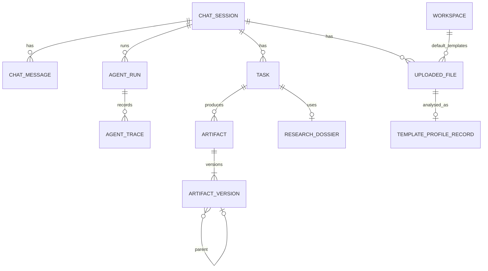

# Data Models and Contracts

Authoritative definitions live in `app/models/` (Pydantic v2 and SQLAlchemy 2). This document explains purpose, relationships and invariants. Markers: **[now]** in code today · **[Sn]** added in PLAN stage *n*. Persisted JSON documents carry `schema_version` (content models, interpretation, dossier, quality report).

Related: [ARCHITECTURE](architecture/ARCHITECTURE.md) · [DECISIONS](architecture/DECISIONS.md) · [QUALITY](QUALITY.md)

## 1. Entity overview



## 2. Relational tables

| Table | Model | Key columns | State |
|---|---|---|---|
| `chat_sessions` | `ChatSession` | `session_id`, `title`, `owner`, timestamps | now |
| `chat_messages` | `ChatMessage` | `session_id`, `role` (user/assistant/system), `content`, `run_id`, `meta_json` (artifact refs) | now |
| `agent_runs` | `AgentRun` | `run_id`, `session_id`, `status` (running/done/failed), `plan_json`, `result_json` (reply, request, file_ids, artifacts, citations, validation, errors, `clarification_for`, `usage`), `started_at`, `finished_at` | now |
| `agent_traces` | `AgentTrace` | `trace_id` (= run_id), `agent_name` (node), `status` (ok/error), `duration_ms`, `input_summary`, `output_summary`, `model_name`, `cache_hit` | now |
| `uploaded_files` | `UploadedFile` | `filename`, `file_type`, `file_size`, `stored_path`, `session_id`, `purpose` (REFERENCE/TEMPLATE/SOURCE/DATASET), `sha256`, `owner` | now |
| `artifacts` | `Artifact` | `title`, `artifact_type` (docx/pptx/xlsx), `session_id`, `run_id`, `owner`, `task_id` | now |
| `artifact_versions` | `ArtifactVersion` | `artifact_id`, `version_no`, `model_json` (IR), `file_path`, `file_type`, `parent_version_id`, `change_summary`, `source_ids_json`, `sources_json`, `diff_json`, `quality_json`, `dossier_id` | now |
| `sources` | `Source` (ORM) | knowledge-base chunks: `kind` (web/kb), `url`, `title`, `chunk_text`, `metadata_json` | now |
| `template_profile_records` | `TemplateProfileRecord` | `file_id`, `profile_json` | now |
| `workspaces` | `Workspace` | default DOCX/PPTX template file IDs, cached `doc_profile_json` / `ppt_profile_json`, `logo_path`, `is_active` | now |
| `tasks` | `Task` | `session_id`, `owner`, `objective`, `output_spec_json`, `status` (active / awaiting_clarification / done / failed), `template_file_id`, `source_file_ids_json`, `dossier_id` | now (`services/task_state.py`); artifacts carry `task_id` |
| `research_dossiers` | `ResearchDossierRecord` | `task_id`, `session_id`, `dossier_json` | now (table S3; filled S5) |

## 3. Workflow state — `GraphState` (`app/agents/state.py`) [now]

TypedDict shared by graph nodes. Keys: `run_id`, `session_id`, `user_message`, `file_ids`, `plan` / `execution_plan`, `session_context`, `template_profiles` (profiles + template paths), `registry` (sources map), `findings`, `evidence_pack`, `doc_model`, `deck_model`, `workbook_model`, `artifacts`, `validation`, `retry_count`, `reply`, `errors` (internal), `failure` (plain-language reply of the first failed node), `clarification_for`, capability bookkeeping. Invariant: any key a node writes must be declared here (LangGraph drops undeclared keys). Stage 4 added `interpretation` (summary dict), `task_id`, `kind_hint`, `pending_clarification`, `raw_message`. Stage 5 added `dossier` (summary: sources, evidence, questions, answered/partial/unanswered, conflicts, coverage_pct, gaps, providers, reused), `dossier_id`, `research_summary`. Later: `quality_report` [S8].

## 4. Conversation and interpretation

### 4.1 `ConversationContext` (`app/models/context.py`) [now]
`recent_messages`, `conversation_summary`, `active_artifact`, `active_version`, `artifact_history` (id, kind, title, latest version), `recent_operations`, `relevant_sources`, `active_template`, `current_topic`, uploaded files with roles.

### 4.2 `ExecutionPlan` (`app/models/execution_plan.py`) [now]
Interpreter output today: `goal`, `operation` (`OperationType`: CREATE, EDIT, REGENERATE, APPEND, INSERT, DELETE, REPLACE, MOVE, RESTYLE, REFRESH, CONVERT, ANSWER), `artifact_types`, `target_artifact_id(s)`, `target_nodes`, `template_mode`, `template_file_ids`, `source_file_ids`, `attachment_roles`, `source_requirements`, `document_type`, `slide_count`, `topic`, `confidence`, `ambiguity`, `clarification_needed`, `error` (e.g. `CLARIFICATION_NEEDED`, `TEMPLATE_FILE_REQUIRED`), `action` (generate/edit/convert/answer), `outputs`, `answer_scope`.

### 4.3 `Interpretation` [now — `app/models/interpretation.py`, produced by `app/agents/interpreter.py`; summary stored in `agent_runs.result_json.interpretation`]
Wraps and extends `ExecutionPlan` (kept for compatibility):

```text
Interpretation
  kind: new_task | continue_task | modify_artifact | regenerate | change_objective
        | clarification_answer | question | retry
  confidence: 0..1
  objective: str
  output_spec: OutputSpec?
  change: ChangeRequest?          # required when kind = modify_artifact
  research: ResearchNeed          # depth none|light|standard|deep, rationale
  clarification_questions: [ClarificationQuestion{question, options[]}]
  assumptions: [str]              # e.g. "format inferred as PPTX from 'deck'"
  referenced_file_ids: [int]

OutputSpec
  format: pptx | docx | xlsx
  purpose, audience, tone, language, detail_level: brief|standard|detailed
  length: LengthSpec{unit: slides|pages|words|sheets|auto, value?, explicit: bool}
  citation_style: numeric | apa | harvard | none
  style_notes: [str]

ChangeRequest
  operation: restyle | rewrite | add | remove | reorder | expand | condense | replace_data | regenerate | convert
  scope: ChangeScope{level: artifact|unit|element|style, targets: [TargetRef]}
  instruction: str
  style_changes: [StyleChange{path, value}]   # deterministic restyle, e.g. heading_1.size_pt = 20

TargetRef
  kind: slide | section | sheet | element | table | chart | paragraph | style
  locator: str            # as the user said it
  node_id: str?           # resolved by the resolver
```

Invariants: `modify_artifact` ⇒ `change` present; unit-level scope ⇒ at least one target; confidence < 0.6 ⇒ clarification questions present.

## 5. Research and evidence

### 5.1 Today [now]
`SourceRegistry` (`services/source_registry.py`): integer citation IDs → `{kind (web/kb), title, url_or_path, snippet, score, published_date}`; deduplicates URLs. `ResearchResult` (`web_research.py`): queries, `FindingItem{text, source_ids}`, source IDs. `EvidenceItem` in `services/evidence_pack.py` for retrieved KB passages.

### 5.2 Dossier [now — `app/models/evidence.py` (`SourceRecord` is the source model), produced by `app/agents/research_pipeline.py`, stored in `research_dossiers`, linked from `tasks.dossier_id` and `artifact_versions.dossier_id`]

```text
ResearchPlan
  depth: none | light | standard | deep
  questions: [ResearchQuestion{id, question, priority 1-3, rationale}]

Source
  id: int (citation number space)        kind: web | paper | user_file | kb | dataset
  url?, file_id?, locator?, title, publisher?, authors[], venue?, doi?
  published_at?, retrieved_at, authority: high|medium|low, authority_rationale

EvidenceItem
  id: "e12"   source_id   question_ids[]
  statement: str   value?: float   unit?: str   as_of?: str
  quote?: str (verbatim, ≤ 300 chars)   locator: str (page / section / URL fragment)

Claim
  id: "c7"   statement: str
  status: supported | assumption | interpretation | estimate | unsupported
  evidence_ids: [str]          # required when status = supported
  conflict_note?: str

ResearchDossier
  plan, sources[], evidence[], claims[], conflicts[{claim_ids, note}],
  coverage: {answered[], partial[], unanswered[]}, gaps[str], providers_used[], provider_errors[]
```

Invariants: every `evidence.source_id` exists; every supported claim has ≥ 1 evidence item; citation numbers on rendered output resolve to `Source.id`.

## 6. Templates

### 6.1 `TemplateProfile` (`app/models/template_profile.py`) [now]
`file_id`, `file_type`, `source_name`, `doc_style: DocStyleProfile`, `ppt_style: PptStyleProfile`, `tone: ToneProfile`, `content_summary`, `text_preview`, `analyzer_version` (stale when < `ANALYZER_VERSION`; see `is_current_profile`).

- `PptStyleProfile`: slide size, theme fonts/colours, `layouts: [SlideLayoutInfo{index, name, role, placeholders[], decoration_score}]`, `layout_roles`, `existing_slides`, `slide_design: SlideDesign`.
- `SlideDesign`: `design_mode` (layouts/slides), `slide_bases: [SlideBase]`, `slide_fonts`, `slide_palette`, `slide_text_color`, `slide_background`, theme colours/fonts.
- `SlideBase`: `index`, `kind` (cover/section/content/closing/diagram), `title_shape`, `subtitle_shape`, `remove_shapes[]`, `photo_shapes[]`, `frame_shapes[]`, `region: Box`, `region_color`, `score`.
- `DocStyleProfile`: page size, margins, heading styles, body font, line spacing, list/table styles, header/footer text, palette, outline.

### 6.2 Manifest extensions [now] (ADR-027)
- `TemplateProfile` adds `xlsx_style: XlsxManifest`, `design_tokens: DesignTokens`, `sha256`.
- PPTX: `PptStyleProfile.inventory: [SlideInventory{index, layout_name, elements[]}]`, `ElementInfo{shape_index, name, kind, role: structural|branding|decorative|placeholder|sample_content, box, z, placeholder_type, text_preview, font, fill_color, has_image, reason}`; `PptStyleProfile.branding` (master/layout logos and repeated marks); `SlideLayoutInfo.archetype` (title, section, bullets, two_column, comparison, image_text, quote, timeline, closing, title_only, blank, …).
- DOCX: `DocStyleProfile.manifest: DocxManifest{sections: [DocxSection{orientation, size, margins_in, header_text, footer_text, has_page_number, different_first_page}], styles_by_role: {role: DocxStyleInfo{style_name, font, size_pt, …}}, list styles, numbering_definitions, cover_lines, cover images, tables, has_toc, theme}`.
- XLSX: `XlsxManifest{sheets: [XlsxSheetInfo{name, role, used_range, header, freeze_panes, tables, formula_count, formula samples, references_sheets, number_formats, conditional_formats, data_validations, merged ranges, charts{type, title, series}, images}], defined_names, theme colours}`.
- `DesignTokens{heading_font, body_font, primary, secondary, accents, text, background, source}`.
- Cache: `template_profile_records.sha256` + `analyzer_version` (`services/template_cache.cached_profile`).

## 7. Content models (IR)

Per ADR-003 the existing models are the IR, extended in place. All carry `node_id` (stable, assigned by `services/artifact_nodes.ensure_node_ids`) used by editing and diffs.

### 7.1 Deck — `DeckModel` / `SlideModel` / `BulletItem` (`app/models/deck_model.py`)
[now] `DeckModel{title, subtitle, slides[]}`; `SlideModel{role: title|section_header|title_content|two_content|title_only, title, subtitle, bullets[], left[], right[], notes, source_ids[]}`; `BulletItem{text, level 0-1, source_ids[]}`.

[now, Stage 7] additions (rendering of blocks: Stage 8):

```text
SlideModel
  archetype: title | agenda | section | bullets | two_column | comparison | timeline | process
             | chart | table | kpi | quote | image_text | summary | closing | references
  key_message: str            # the one sentence the slide must land
  blocks: [Block]             # typed content, see below
  claim_ids: [str]
  layout_hint: str?           # template base / layout chosen, recorded for stable re-renders

Block (discriminated by type)
  bullets     {items[{text, level, claim_ids[]}]}
  table       {columns[], rows[[]], caption?, claim_ids[]}
  chart       {chart_type: bar|column|line|pie|doughnut|area|scatter|stacked_bar|stacked_column,
               categories[], series[{name, values[]}], unit?, title?, claim_ids[]}
  timeline    {events[{date, label, detail?}]}
  process     {steps[{label, detail?}]}
  comparison  {columns[{heading, points[]}]}
  kpi         {items[{value, label, delta?, claim_ids[]}]}
  quote       {text, attribution?, claim_ids[]}
  image       {description, alt_text, asset_path?, credit?}
  callout     {text}
DeckModel
  schema_version, style: StyleOverrides?, citation_style
```

Compatibility: `role` maps to an archetype when `archetype` is absent; `bullets`/`left`/`right` render as bullets/comparison blocks.

### 7.2 Document — `DocumentModel` / `Section` / blocks (`app/models/document_model.py`)
[now] `DocumentModel{title, subtitle, client_name, date, sections[]}`; `Section{heading, level, blocks[]}`; blocks `paragraph{text, source_ids}`, `bullets{items, ordered, source_ids}`, `table{headers, rows, source_ids}`.

[S7/S9] additions: `schema_version`, `front_matter{executive_summary?, abstract?, toc: bool}`, `citation_style`, `style: StyleOverrides?`, `Section.purpose`, block types `figure{chart spec | image, caption}`, `callout`, `quote`, and `claim_ids` on every block (`source_ids` kept for compatibility).

### 7.3 Workbook — `WorkbookModel` (`app/models/workbook_model.py`)
[now] `WorkbookModel{title, sheets[]}`; `SheetModel{name, cells[], tables[], charts[]}`; `CellModel{coordinate, value, formula, data_type, format}`; `TableModel{name, range, headers, rows}`; `ChartModel{title, chart_type, data_range, categories_range}`.

[S10] additions: `SheetModel.role` (readme | assumptions | data | calculations | report | dashboard | sources), `TableModel.columns[{name, type, unit, number_format, formula?}]`, `named_ranges[{name, ref}]`, `conditional_formats[]`, `validations[]`, `checks[{ref, expected, tolerance}]`, `assumptions[{name, value, unit, source_id|rationale}]`.

### 7.4 `StyleOverrides` [S9/S11]
Explicit, deterministic formatting changes requested by the user: `{heading_1.size_pt, heading_2.size_pt, body.size_pt, body.font, accent_color, line_spacing, ...}`. Renderers apply them to styles (DOCX named styles, PPTX text roles, XLSX header styles), never by rewriting content.

## 8. Editing

### 8.1 `EditPlan` and operations (`app/models/edit_ops.py`) [now]
`EditPlan{target: docx|pptx|xlsx|both, ops[], summary}`. Operations: `add_section`, `update_section`, `update_paragraph`, `delete_section`, `add_slide`, `update_slide`, `delete_slide`, `move_slide`, `condense_deck`, `refresh_with_web`, `update_title`, `add_sheet`, `update_sheet`, … each addressing node IDs or headings.

[S11] additions: `restyle{style_changes[]}` (no LLM), `replace_block{node_id, block}`, `update_chart_data{node_id, series}`; scope guard result `{allowed_ops, rejected_ops[{op, reason}]}`; regression diff `{changed_node_ids, unchanged_node_ids_verified}`.

### 8.2 Versions [now]
`ArtifactVersion` row (§2) is immutable; `diff_json` from `services/diffing.py`; revert creates a new version copying an earlier one.

## 9. Quality

### 9.1 Today [now]
`ValidationReport{passed, score 0-100, issues[ValidationIssue{severity: error|warning, where: "pptx:slide_3" | "docx:section_2" | "xlsx:sheet_1" | "scope:…", message}]}` from `validate_outputs` (model) merged with `validate_pptx_file` (file) via `merge_report`.

### 9.2 `QualityReport` [schema S3 — `app/models/quality.py`; produced S8]

```text
QualityReport
  schema_version, artifact_version_id
  verdict: pass | pass_with_warnings | fail
  counts: {detected, corrected, unresolved, not_performed}
  findings: [Finding]
  not_performed: [{check_id, reason}]      # e.g. "LibreOffice not installed"
  evidence_summary: {sources_used, coverage_pct, unsupported_claims[], gaps[]}
  iterations: int

Finding
  check_id: "pptx.text_overflow"   tier: 1-5
  severity: critical | major | minor | info
  status: detected | corrected | unresolved
  where: {unit: node_id | "slide 3", element?: shape name}
  message: str (plain language)
  repair?: {action, by: deterministic|llm}
```

`ValidationReport` stays as the API's `validation_report` for compatibility; it is derived from `QualityReport` (errors = unresolved critical/major).

## 10. Media

`PhotoAsset` (`services/images.py`) [now]: `path`, `credit`, `landing_url`, `alt_text`; passed to `render_pptx(photos={slide index: PhotoAsset})`.

## 11. API payloads (selected) [now]

- `POST /chat` → `{message, file_ids[], session_id?}` → `202 {run_id, session_id, status}` or `{status: done, reply}` for file-only messages; 422 when empty.
- `GET /runs/{id}` → `{status, trace_steps[], reply, artifacts[], citations, validation_report, errors}`.
- `GET /sessions` → `[{session_id, title, message_count, last_activity}]`.
- `GET /artifacts/{id}/previews?version&width` → `{slides: [base64 PNG]}`.
- `POST /files/upload?purpose&session_id` → file record.
