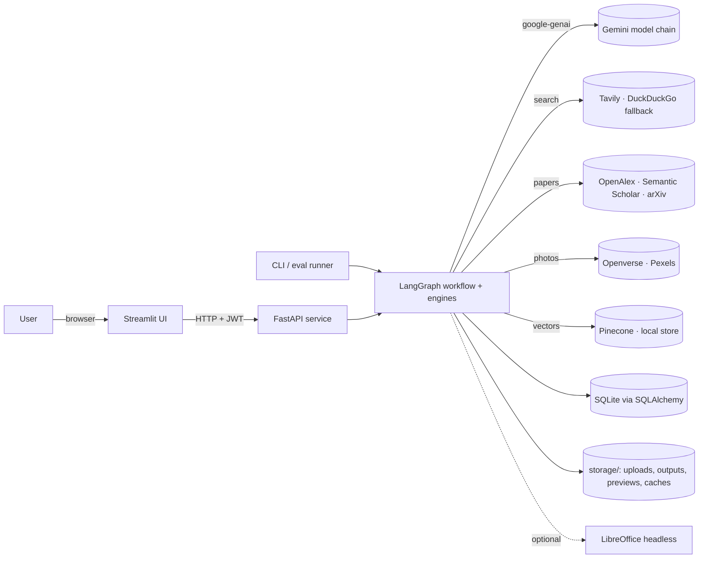
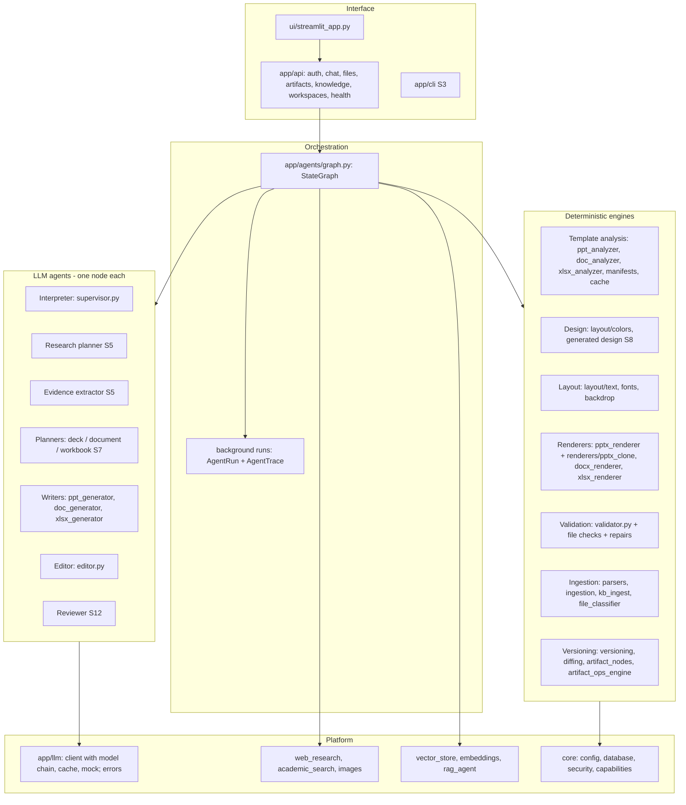
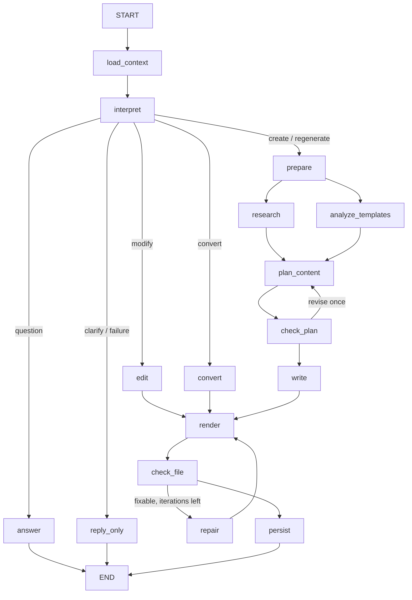
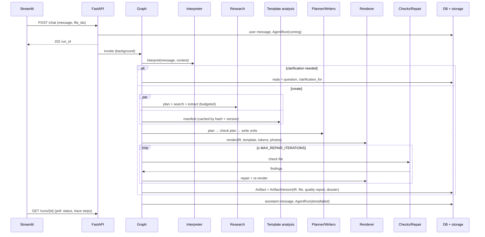
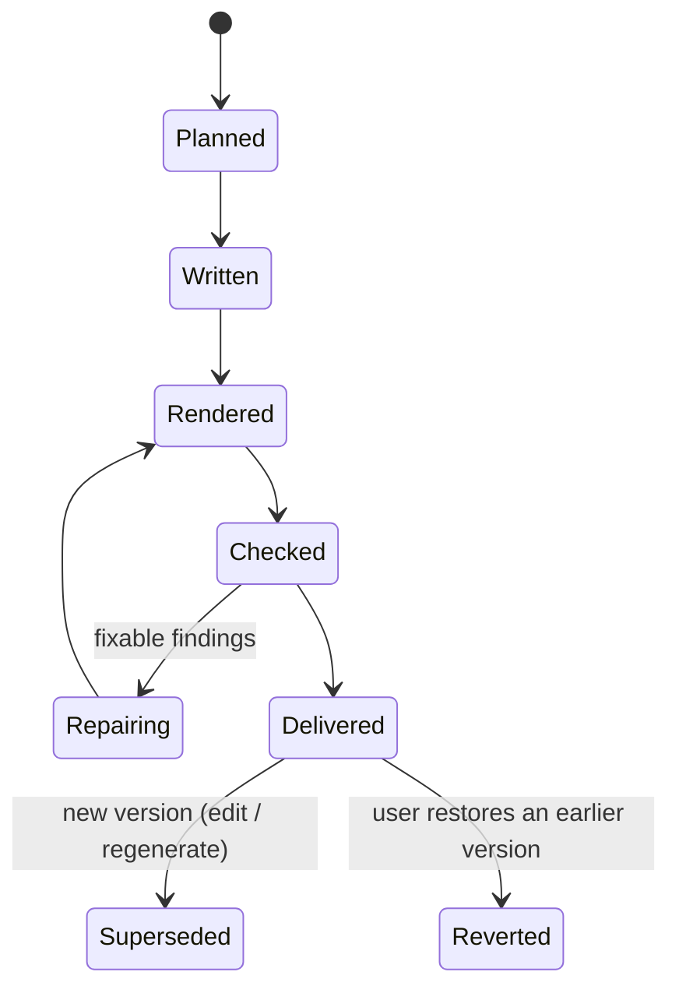

# Architecture Specification

| Field | Value |
|---|---|
| Status | Stage 2 — target architecture baselined; current state marked per component |
| Related | [PRD](../PRD.md) · [DECISIONS](DECISIONS.md) · [DATA_MODELS](../DATA_MODELS.md) · [QUALITY](../QUALITY.md) · [TESTING](../TESTING.md) · [PLAN](../PLAN.md) |

Markers: **[now]** exists in the code today · **[Sn]** added or changed in PLAN stage *n*.

## 1. Principles

1. **The graph orchestrates, agents reason.** A LangGraph `StateGraph` of deterministic nodes drives every request. LLM calls are narrow, typed (Pydantic in, Pydantic out) and owned by one node. No free-roaming agent loop owns the pipeline (ADR-002).
2. **The content model is the source of truth.** Every artifact version stores its typed content model (deck / document / workbook IR). Files are rendered from IR + template + design tokens, deterministically. Edits are patches to the IR (ADR-003).
3. **Evidence is data.** Sources, evidence items and claims are records with IDs; the IR references claims, never free-text citations (ADR-006).
4. **Templates are analysed, not pasted.** A template becomes a manifest + design tokens + the original package that renderers build on (ADR-007).
5. **Validate the file.** Checks read the saved file. Checks that cannot run are reported as not performed, never as passed (ADR-009).
6. **Every message gets an honest reply.** Failures are explained in plain language; partial results are never presented as complete (ADR-015).
7. **Replaceable parts.** LLM model chain, search providers, vector store, image provider, renderers and checks sit behind small interfaces (ADR-004, ADR-005).

## 2. System context

## 3. Component view

### 3.1 Component responsibilities

| Component | Location | Responsibility | State |
|---|---|---|---|
| Streamlit UI | `ui/streamlit_app.py` | Chat, history sidebar, uploads with role, live progress, download cards, thumbnails, quality report. HTTP only, no business logic. | now |
| REST API | `app/api/*` | JWT-protected, owner-scoped endpoints (`core/ownership.py`); starts background runs; serves status, traces, files, previews, versions; `AppError` → status + message. | now |
| CLI | `app/cli.py` | `health`, `analyze-template`, `generate` (same workflow and persistence as chat); `eval` added in S12. | now |
| Workflow | `app/agents/graph.py` | LangGraph nodes and routing for create / answer / edit / convert / clarify; per-node trace rows; plain-language failure capture. | now; restructured S4–S11 |
| Interpreter | `app/agents/supervisor.py` (planner), `app/agents/interpreter.py`, `app/services/task_state.py` | Planner produces the `ExecutionPlan`; the interpreter derives the `Interpretation` (kind, output spec, change request with node-ID targets, research depth, clarification) without another LLM call (ADR-025); task state persists across turns. | now |
| Conversation context | `services/session_context.py`, `context_builder.py`, `reference_resolver.py`, `target_resolver.py` | Recent turns, artifact outlines with node IDs, uploaded files with roles, reference resolution. | now; S4 |
| Research | `agents/research_pipeline.py`, `agents/web_research.py` (search), `services/academic_search.py`, `services/source_quality.py`, `services/page_fetch.py`, `services/source_registry.py`, `services/context_builder.py`, `services/evidence_pack.py` | Research plan, search, page reading, source rating, verified evidence, claims, conflicts, coverage, dossier; writers get facts cited by source ID plus limitations (ADR-026). | now |
| Knowledge base | `services/kb_ingest.py`, `vector_store.py`, `embeddings.py`, `agents/rag_agent.py` | Chunk, embed and retrieve user and workspace sources (Pinecone or local). | now |
| Template analysis | `agents/ppt_analyzer.py`, `agents/doc_analyzer.py`, `agents/xlsx_analyzer.py`, `services/analyzers/slide_design.py`, `services/analyzers/pptx_manifest.py`, `services/analyzers/docx_manifest.py`, `services/analyzers/xlsx_manifest.py`, `services/analyzers/template_package.py`, `services/template_cache.py` | Template manifests (element roles, layout archetypes, branding; DOCX sections/styles; XLSX sheets/formulas/charts) and design tokens for all formats; template packages; profiles cached by content hash + analyser version (ADR-027). | now |
| Planning & writing | `agents/ppt_generator.py`, `doc_generator.py`, `xlsx_generator.py` | Today: one call per format producing the content model. Target: plan (structure, archetypes, claim links) then write per unit. | partial; S7 |
| Layout | `services/layout/*` | Text measurement and fitting, backdrop colour, contrast and tokens. | now |
| Renderers | `services/pptx_renderer.py`, `services/renderers/pptx_clone.py`, `pptx_canvas.py`, `docx_renderer.py`, `xlsx_renderer.py` | IR + template → file. PPTX: layout path and designed-slide clone path. | partial; S8–S10 |
| Previews | `services/renderers/pptx_preview.py` | PNG thumbnails without LibreOffice. | now |
| Validation & repair | `agents/validator.py` | Model checks + rendered-file checks; repairs; quality report. | partial; S8–S12 |
| Editing & versions | `agents/editor.py`, `agents/converter.py`, `services/versioning.py`, `diffing.py`, `artifact_nodes.py`, `artifact_ops_engine.py` | Edit plans as operations on node IDs; immutable versions with diffs; revert; conversion. | now; S11 |
| LLM client | `app/llm/client.py`, `app/llm/errors.py`, `app/llm/usage.py` | `google-genai` calls with structured output, disk cache, model chain (404 skip, quota skip, short-429 wait, 401/403 stop), per-run budget and usage, mock mode for tests, plain-language errors. | now |
| Media | `services/images.py` | Openverse/Pexels photos with credits for template photo frames. | now |
| Persistence | `app/core/database.py`, `app/models/*` | SQLAlchemy models, async (API) and sync (graph) sessions, column migrations (`ADDED_COLUMNS`), interrupted-run recovery. | now |

### 3.2 Legacy code (removed in Stage 3)

An older parallel pipeline — services/orchestrator, services/renderers/{pptx,docx}_renderer, llm/schemas, the unmounted api/upload router, services/analyzers/{pptx,docx,pdf,image,xlsx}_analyzer, progressive_discovery and the agents generator / researcher / kb_retriever (which imported a state class that no longer existed) — was removed after confirming that no mounted route, graph node, script or test used it (ADR-019). `services/analyzers/slide_design.py` is the only module kept in that package.

## 4. Agents

All agents call the LLM through `get_llm_client()` with a Pydantic schema; they do not touch files or the database. The node that calls them persists results.

| Agent | Node | Input | Output | State |
|---|---|---|---|---|
| Interpreter | `plan_node` | message, conversation context, file roles | `ExecutionPlan` → `Interpretation` | now; S4 |
| Research planner | `research_node` | objective, output spec, prior dossier | `ResearchPlan` (questions, depth) | S5 |
| Evidence extractor | `research_node` | source text + questions | `EvidenceItem[]`, conflicts | S5 |
| Deck / document / workbook planner | `plan_content_node` | objective, spec, dossier digest, template summary | plan IR (structure, archetypes, claim links) | S7 |
| Writers | `generate_*_node` | plan unit + evidence + style guide | filled IR units | now (single call); S7 per unit |
| Editor | `edit_node` | change request, targeted units, neighbours, evidence | `EditPlan` operations confined to targets | now; S11 |
| Reviewer | `validate_node` | content digest + plan + evidence | content findings | S12 |
| Template tone analyser | `analyze_templates_node` | sample text | `ToneProfile`, summary | now |

## 5. Workflows

### 5.1 Graph (target)

Today's graph: `load_context → plan → {answer | stub | edit | convert | analyze_templates → gather_context → generate_doc → generate_deck → generate_sheet → validate → (retry once) → finalize}`; file checks and the shorten round run inside `finalize`. Stages 4–11 move to the target shape node by node.

### 5.2 Generation sequence

### 5.3 Edit sequence

1. Build context: artifact outline with stable node IDs (`services/artifact_nodes.py`).
2. Interpret: `modify` with change request (scope + operation).
3. Resolve targets to node IDs; 0 or > 1 candidates for a unit-scoped change → clarify.
4. Style-only change → deterministic patch of IR style / template style (no LLM). Content change → Editor produces operations limited to targets.
5. Scope guard rejects operations outside targets (`validate_scope`).
6. Render the new version; check changed units and global rules; regression diff confirms out-of-scope units unchanged.
7. Persist version with parent link and diff.

### 5.4 Clarification policy

Ask instead of acting when: interpreter confidence < `CLARIFY_THRESHOLD` (0.6); the topic is an unexplained ambiguous acronym; target resolution gives 0 or > 1 candidates; the change would rewrite > 50 % of units while naming a narrower scope; a required input is missing ("use my template" with none attached). The next user message is merged with the pending request (`clarification_for`).

## 6. Template-aware rendering

**PPTX** (ADR-007, ADR-016):
- *Layout path* (design lives on masters/layouts): delete sample slides, choose the best layout per archetype, fill placeholders, compose extra shapes inside the content region, add light decoration only when the layout has none.
- *Clone path* (design lives on sample slides — Canva-style): analyse sample slides into bases; clone the best base per slide; remove sample text; keep artwork; fill title/subtitle slots in template style; compose content in the freed region; fill photo frames; remove samples at the end.
- No template (S8): generated design tokens (palette by topic/tone, fonts, grid) on a blank 16:9 deck.

**DOCX:** copy the template; clear the body keeping the final section properties (headers, footers, margins); write content with template style names mapped by role; style edits change styles, not runs (S9).

**XLSX:** classify template sheets by role; keep structures, formats and formulas; replace sample data rows with planned data (S10).

## 7. Validation and repair

A registry of checks per format and tier (QUALITY §2). Each check returns passed / failed / not performed (with reason). Repairs are registered per finding type: deterministic first (shrink to floor, grow box, remove empty placeholder, delete residue, fix reference), then LLM (one "shorten" re-plan, rewrite with evidence). The loop stops when nothing fixable remains or `MAX_REPAIR_ITERATIONS` (default 2, free-tier budget) is reached. The `QualityReport` records detected, corrected and unresolved findings and checks not performed.

Today: model checks (`validate_outputs`), PPTX file checks (`validate_pptx_file`), one shorten round (`_render_checked_deck`).

## 8. Persistence

- **Relational (SQLite, SQLAlchemy 2):** `chat_sessions`, `chat_messages`, `agent_runs`, `agent_traces`, `uploaded_files`, `artifacts`, `artifact_versions`, `sources`, `template_profile_records`, `workspaces`, `projects`, `users` [now]; `tasks`, `research_dossiers`, quality report and dossier columns on `artifact_versions` [S3/S5].
- **Files (`storage/`):** uploads, rendered outputs, photos, preview PNGs, LLM and search caches.
- **Vectors:** Pinecone index or local store, one namespace per workspace/session.
- JSON documents (IR, manifests, dossiers, reports) carry `schema_version`.

## 9. Error handling

- LLM: model chain — 404 → skip model 24 h; daily quota or long `RetryInfo` → skip until retry time; short 429 → wait advised delay; 5xx → backoff; every model exhausted → `LLMRateLimited(quota=True)` (ADR-015).
- Invalid structured output: one re-ask with the validation error (writers), then the node fails.
- A failing node records a trace row with status `error` and a plain-language `failure`; routing sends planner failures to a reply-only node; generation failures produce a failure reply when nothing was delivered; runs are marked `failed` and "try again" re-runs the stored request.
- Research, photos and scholarly sources degrade with a reported gap, never by inventing content.

## 10. Security boundaries

- JWT on all routes except login and health; sessions, files and artifacts scoped to their owner; other owners' records answer 404 (ADR-014).
- Uploads judged by content: format parts, signatures, size limit (`UPLOAD_MAX_MB`), ZIP entry/size/ratio limits, macros refused (ADR-023).
- Retrieved web/file/paper text is wrapped in delimited blocks marked "data, not instructions" in every prompt [S5].
- Keys only from environment/`.env`; never logged or stored.
- Downloads served by artifact ID; file paths never taken from user input.

## 11. Artifact lifecycle

Each `ArtifactVersion` is immutable: IR (`model_json`), file, parent version, change summary, diff, sources, quality report and dossier reference.

## 12. Configuration

`pydantic-settings` from `.env` (`app/core/config.py`): Gemini key and model chain, Tavily/Pinecone/Pexels/Semantic Scholar keys, research and image switches, database URL, storage dir, JWT, upload limit, default templates, `MOCK_LLM` (tests only), thresholds. See DEPLOYMENT (Stage 13).

## 13. Requirement ownership

Every PRD functional requirement has an owning component. Stage numbers say where unmet requirements are completed.

| Requirements | Owning component(s) | Stage |
|---|---|---|
| FR-CONV-1, FR-CONV-8, FR-CONV-10 | `api/chat.py`, `graph.ensure_reply`, `llm/errors.py`, DB models | now |
| FR-CONV-2, FR-CONV-3, FR-CONV-4, FR-CONV-6, FR-CONV-7 | Interpreter (`supervisor.py` → `Interpretation`), clarification policy | S4 |
| FR-CONV-5, FR-CONV-9 | `reference_resolver`, `target_resolver`, `session_context`, `answer_node` | S4 |
| FR-RES-1, FR-RES-2, FR-RES-6, FR-RES-7, FR-RES-8, FR-RES-9, FR-RES-10, FR-RES-11, FR-RES-12 | Research pipeline (`web_research`, `source_registry`, evidence models), `research_node` | S5 |
| FR-RES-3, FR-RES-4 | `web_research`, `academic_search` | S5 |
| FR-RES-5 | `parsers`, `kb_ingest`, `vector_store`, `rag_agent` | S5 |
| FR-TPL-1, FR-TPL-2, FR-TPL-3, FR-TPL-4, FR-TPL-7 | `ppt_analyzer`, `slide_design`, template manifest | S6 |
| FR-TPL-5 | `doc_analyzer` | S6 |
| FR-TPL-6 | XLSX template analyser | S6 |
| FR-PLAN-1, FR-PLAN-2, FR-PLAN-3, FR-PLAN-4, FR-PLAN-5, FR-PLAN-6, FR-PLAN-7 | Planners + writers, plan checks in `validator.py` | S7 |
| FR-PPTX-1, FR-PPTX-2, FR-PPTX-3, FR-PPTX-4, FR-PPTX-5, FR-PPTX-6, FR-PPTX-7, FR-PPTX-8 | `pptx_renderer`, `pptx_clone`, `pptx_canvas`, `layout/*`, `images` | S8 |
| FR-DOCX-1, FR-DOCX-2, FR-DOCX-3, FR-DOCX-4, FR-DOCX-5, FR-DOCX-6 | `docx_renderer`, `doc_generator`, `doc_analyzer` | S9 |
| FR-XLSX-1, FR-XLSX-2, FR-XLSX-3, FR-XLSX-4, FR-XLSX-5, FR-XLSX-6, FR-XLSX-7, FR-XLSX-8 | `xlsx_generator`, `xlsx_renderer`, formula evaluator, dataset ingestion | S10 |
| FR-VAL-1, FR-VAL-2, FR-VAL-3, FR-VAL-4, FR-VAL-5, FR-VAL-6 | `validator.py` check registry, repairers, `QualityReport`, Reviewer | S8–S12 |
| FR-EDIT-1, FR-EDIT-2, FR-EDIT-3, FR-EDIT-4, FR-EDIT-5 | `editor`, `converter`, `versioning`, `diffing`, `artifact_nodes`, `artifact_ops_engine` | S11 |
| FR-UX-1, FR-UX-2, FR-UX-3, FR-UX-4, FR-UX-5 | `ui/streamlit_app.py`, `app/api/*`, `app/cli.py` | S3, S13 |

## 14. Extension points

- New output format: content model + planner/writer + renderer + checks; register in the graph router and `core/capabilities.py`.
- New search or paper index: a function returning `{title, url, snippet, published_date, ...}` registered in the research pipeline.
- New model: add to `GEMINI_MODEL` / `GEMINI_FALLBACK_MODEL`; other vendors only through a new client implementing `generate_text` / `generate_json` (ADR-004).
- New check: a function over the opened file returning findings, registered with tier and severity.
